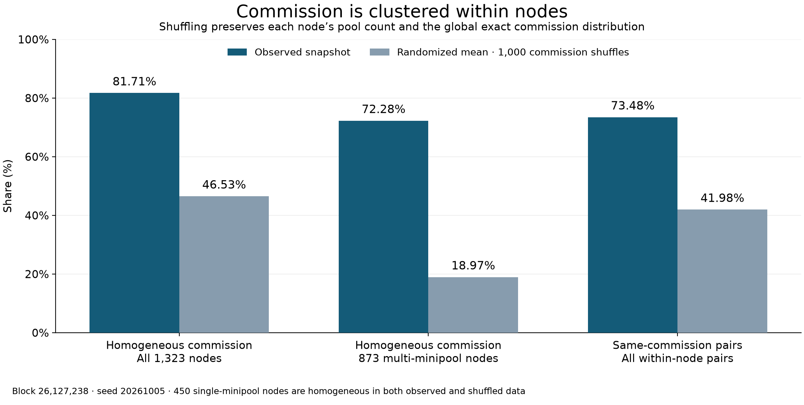
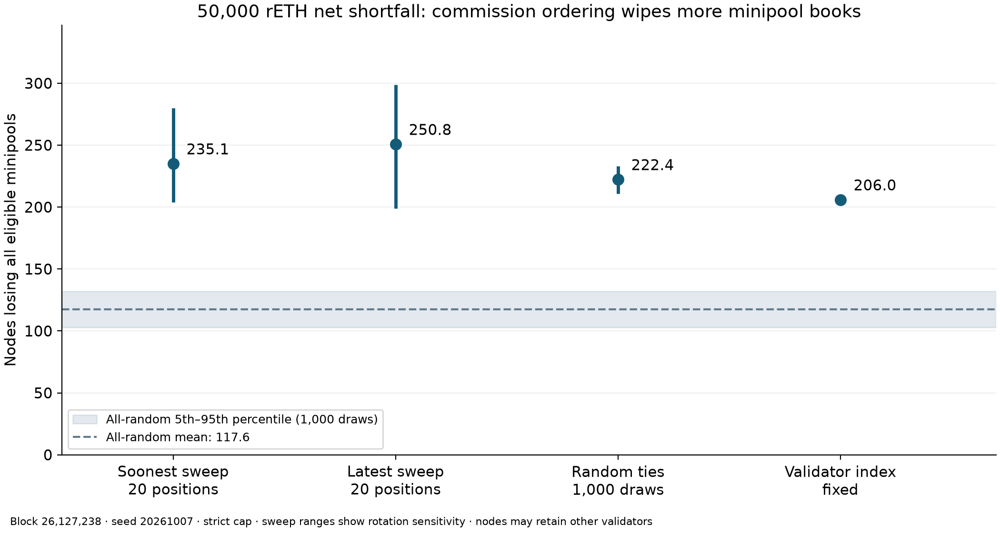
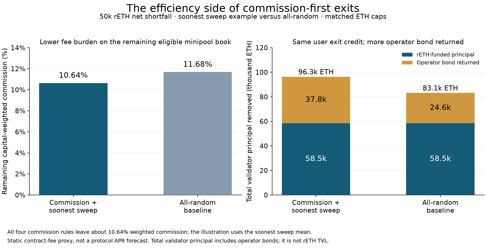
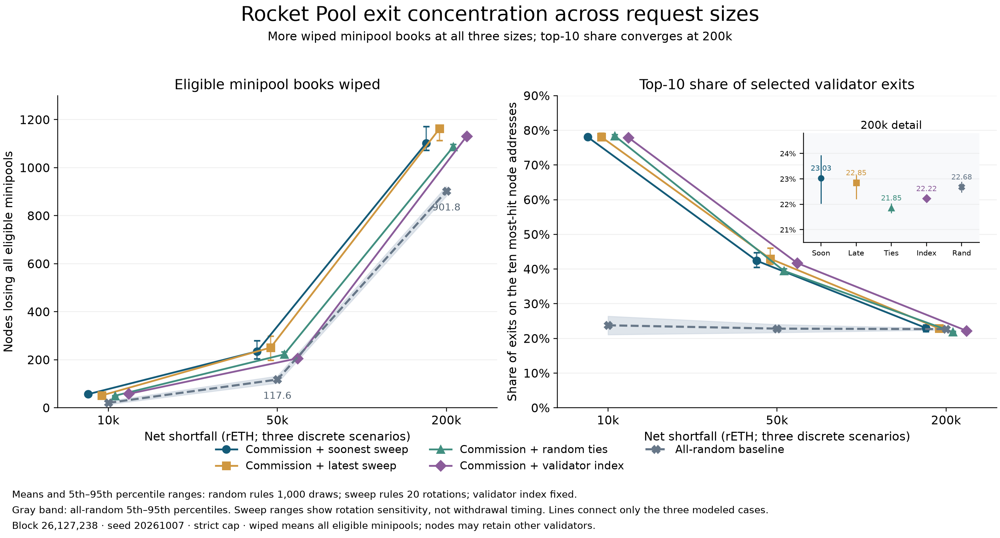

# Commission clustering and minipool exit concentration (RPIP-71, static snapshot)

I tested two things: whether commission is clustered within nodes, and whether RPIP-71's suggested commission-first exit ordering concentrates the burden of providing rETH liquidity. Snapshot: block 26,127,238 (5 Oct 2026, 16:03 UTC), 11,571 eligible minipools across 1,323 nodes. Already-exiting and withdrawn validators are excluded.

## 1. Commission is clustered by node

| | Observed | Randomized mean |
|---|---:|---:|
| Commission-homogeneous nodes (all 1,323) | 81.71% (1,081) | 46.53% |
| Same, multi-minipool nodes only (873) | 72.28% (631) | 18.97% |
| Same-commission pairs within a node | 73.48% | 41.98% |

*Figure 1. Commission similarity exceeds the shuffled baseline, including among multi-minipool nodes. Single-minipool nodes are homogeneous by construction in both cases.*

Randomization shuffles exact commissions across pools, preserving each node's pool count and the global commission distribution (1,000 draws, seed 20261005). The 450 single-minipool nodes (34.01% of nodes, 3.89% of minipools) are homogeneous by construction, so the multi-minipool and pair figures show the result holds without them. The 14% tier holds 58.11% of eligible minipools, so the tie-break matters once a request reaches it.

## 2. Does commission ordering concentrate exits? (50k rETH)

Method:

1. Treat 50,000 rETH as a net shortfall: a priority prefix, sorted by exact commission descending, capped at 58,538.37 ETH, crediting `32 ETH − bond` per exit.
2. Compare four tie-breaks (soonest sweep, latest sweep, random, validator index) with 1,000 uniform random orderings at the same ETH cap. Sweep rules use 20 randomized index rotations.
3. Seed 20261007, rerun with 20261008.

| Tie-break / baseline | Nodes touched | Minipool books wiped | Exits on wiped nodes | Top-10 node share | RPL on wiped nodes |
|---|---:|---:|---:|---:|---:|
| Soonest sweep | 545.5 [493.7–598.0] | 235.1 [203.8–280.1] | 18.2% | 42.4% | 421,731 |
| Latest sweep | 541.1 [489.6–587.6] | 250.8 [198.9–299.0] | 20.4% | 43.0% | 403,226 |
| Random ties | 655.3 [638.0–672.0] | 222.4 [211.0–233.0] | 12.5% | 39.5% | 205,714 |
| Validator index | 598.0 | 206.0 | 12.1% | 41.7% | 632,229 |
| Random baseline | 671.8 [648.0–694.0] | 117.6 [103.0–132.0] | 5.2% | 22.8% | 104,274 |

Cells show mean [5th–95th percentile]. Sweep ranges show rotation sensitivity, not timing. "Wiped" means every eligible minipool of the node was selected. RPL is counted once per wiped node and is exposure, not predicted selling.

*Figure 2. All four commission tie-breaks wipe more eligible minipool books at 50k rETH. Ranges show empirical 5th–95th percentiles; sweep ranges measure cursor sensitivity. Nodes may retain other validators.*

- Commission rules touch fewer nodes but hit them harder. Touched nodes lose on average 57–70% of their eligible minipools, versus 44% under random.
- It isn't just single-pool operators: 59–84 multi-minipool nodes lose their whole book, versus about 16 under random.
- About 195–241 nodes lose all eligible minipools and have no contract-active megapool validators, versus about 112 under random. This is a proxy, not verified operator departures.

## 3. The other side: rETH efficiency

- **Yield.** The remaining capital-weighted commission falls to about 10.64% under all four commission rules, versus 11.68% under random (11.68% before exits). That is a reward factor of 89.36% versus 88.32%, or about 3.1 bps of annual yield at an illustrative 3% gross rate. This is an efficiency proxy, not an APR forecast.
- **TVL.** Both approaches credit about 58.5k ETH to rETH holders. Commission rules exit about 3.0k validators versus about 2.6k, because more of them carry 16 ETH bonds. Total validator principal removed is 96.3k ETH versus 83.1k ETH. The difference is returned operator bond, not extra rETH liquidity.

*Figure 3. Soonest sweep illustrates the efficiency trade-off: lower remaining eligible-minipool commission, similar user exit credit, and more operator bond returned. The fee comparison is a proxy, not an APR forecast.*

## Robustness and limits

The wiped-book result holds with the second seed and when the first cap-crossing validator is included. The 10k and 200k runs also wipe more books, but at 200k the top-10 share under random ties and validator index (21.85% / 22.22%) is below the random baseline (22.68%), so concentration depends on the metric and request size.

*Figure 4. Wiped-book counts exceed random at all three modeled sizes. Top-10 shares converge at 200k, where random ties and validator index fall below the random baseline.*

This tests the suggested ordering policy, not the isolated causal effect of clustering. Draft RPIP; commission priority is a SHOULD and the sweep tie-break a MAY; static snapshot; net shortfall assumed; circular index order is a sweep proxy, not withdrawal time; no operator behaviour, cooldowns or RPL sales modelled. No node-balanced rule was modelled, so there is no measured yield-versus-diversity frontier. The broader ordering comparison is proposed funded work.

Script, CSVs, block, seeds, chart and spreadsheet checks: [repository](https://github.com/winverse2755/rocketpool-minipool-exit-simulation)

@knoshua @epineph: at 50k rETH, commission priority buys roughly 1 percentage point of lower remaining commission (about 3 bps of yield) at the cost of about 206–251 wiped node books versus about 118 under random. What wipe count or top-10 share would you treat as the ceiling for that trade, and would a node-balanced tie-break within the 14% tier, which I haven't modelled yet, change your answer?
