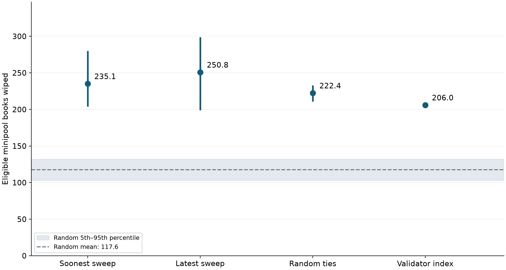

<div align="center">

# Rocket Pool · Minipool Exit Simulation

**How does commission-based ordering distribute validator exits across nodes?**

An offline study built from a fixed Ethereum snapshot.

[Read the findings](reports/REPORT.md) · [Reproduce the analysis](docs/REPRODUCING.md) · [Explore the data](data/) · [Forum post](reports/POST.md)

</div>

---

## Overview

This project compares four commission-based exit orderings—soonest sweep,
latest sweep, random ties, and validator index—with a uniformly random baseline.
It measures how exits are distributed across Rocket Pool node addresses under
three net-shortfall scenarios.

| Snapshot | Population | Scenarios |
| :--- | :--- | :--- |
| Block **26,127,238** | **11,571** eligible minipools | **10k · 50k · 200k rETH** |
| 5 October 2026 | **1,323** node addresses | Two seeds · 1,000 random draws |

## Key finding

At the **50,000-rETH net shortfall**, all four commission tie-breaks select every
eligible minipool on more nodes than the random baseline.



> “Wiped” means all **eligible minipools** on a node are selected. It does not
> mean the operator loses every validator. This is a static scenario, not a
> forecast of operator behavior or RPL sales.

The [full report](reports/REPORT.md) covers the methodology, uncertainty,
additional withdrawal sizes, and limitations.

## Quick start

**Python 3.14** is the tested version. No RPC endpoint, API key, or network
connection is needed after installing dependencies.

```sh
git clone https://github.com/winverse2755/rocketpool-minipool-exit-simulation.git
cd rocketpool-minipool-exit-simulation

python3.14 -m venv .venv
source .venv/bin/activate
python -m pip install -r requirements-lock.txt

python scripts/check_artifacts.py
python scripts/simulate.py
python scripts/verify.py
python scripts/check_artifacts.py --rerun
```

The final check should report **7 file hashes match**. Run from the repository
root, without Python's `-O` flag. On Windows, use `py -3.14 -m venv .venv` and
activate with `.venv\Scripts\Activate.ps1`.

For figures, reports, spreadsheet recalculation, and expected outputs, see the
[reproduction guide](docs/REPRODUCING.md). Reruns overwrite generated files in
`results/` and `figures/`; use a separate checkout for experiments.

## Repository layout

```text
rocketpool-minipool-exit-simulation/
├── data/                   Frozen snapshot and original clustering inputs
├── docs/                   Reproduction guide, provenance, maintenance notes
├── figures/                Publication charts in PNG, SVG, and PDF
├── reports/                Numerical report, forum post, submission bundle
├── results/                Simulation outputs, spreadsheets, verification records
├── scripts/                Simulation, checks, report and figure builders
├── sources/                Saved RPIP specifications and snapshot cross-check
├── requirements.txt        Direct dependencies
├── requirements-lock.txt   Tested environment pins
└── README.md
```

## Explore the study

| I want to… | Start here |
| :--- | :--- |
| Understand the findings | [Numerical report](reports/REPORT.md) or [forum post](reports/POST.md) |
| Inspect the snapshot | [Minipools](data/minipools.csv), [nodes](data/nodes.csv), [snapshot metadata](data/snapshot.json) |
| Trace where the data came from | [Snapshot provenance](docs/provenance.md) |
| Examine the results | [Summary](results/summary.csv), [individual draws](results/draws.csv), [run settings](results/results.json) |
| Check the arithmetic | [Formula workbook](results/hand_check.xlsx) and [verification record](results/verification.json) |
| Reproduce the study | [Step-by-step guide](docs/REPRODUCING.md) |

## Scope

The repository reproduces the exit simulation **from the included snapshot**.
The upstream chain collector and original clustering-shuffle generator are not
included; their inputs and results are preserved. Saved RPIPs reflect the
study's collection period, not necessarily the current protocol.

The model excludes operator responses, migration, liquidity flows, exit timing,
and RPL selling. Node addresses are the unit of analysis, not verified
independent operators.
