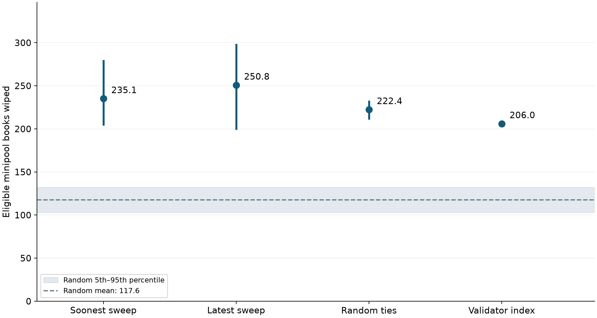

# Does commission ordering concentrate Rocket Pool minipool exits?

The revised [forum post](POST.md) includes the original clustering comparison, the exit simulations, the efficiency discussion, and four supporting charts. The [submission bundle](forum_submission.zip) contains the post and PNGs, with [forum upload instructions](forum_submission_notes.md).

**Yes in this static 50,000-rETH net-shortfall scenario.** All four commission tie-breaks wipe more eligible minipool books than the all-random baseline: means of 235.1 (soonest sweep), 250.8 (latest sweep), 222.4 (random ties), and 206 (validator index), versus 117.6 random [103–132]. The direction holds under a second seed and the tested overshoot rule. This does not establish that one sweep tie-break is consistently better than another, nor that the top-10 share increases at every withdrawal size.

## Method in three lines

1. Use the audited block **26,127,238** snapshot (5 October 2026, 16:03:35 UTC): **11,571 eligible minipools, 1,323 nodes**, at **1.173167372147210985 ETH/rETH**; exclude exiting, withdrawn and slashed validators.
2. Sort exact commissions descending; tie-break by soonest sweep, latest sweep, random, or validator index. Select the largest priority prefix whose `sum(32 − bond)` is at/below net shortfall ETH minus 120 ETH, with no skipping.
3. Compare with **1,000 uniform random orderings without replacement**, also at matched ETH caps; random ties have 1,000 draws, sweep rules use **20 randomized candidate-index rotations**. Seed **20261007**, repeat **20261008**; test strict cap versus including the first crossing validator.

## The table and chart

Cells are mean [empirical 5th–95th percentile], except validator index is fixed. Sweep intervals describe sensitivity across 20 positions; random intervals describe variability across 1,000 draws. Neither is a confidence interval for an estimated mean or a forecast probability of future outcomes. Percentile interpolation can produce fractional node counts.

| Commission tie-break / baseline | Nodes touched | Eligible minipool books wiped | Exits on wiped nodes | Top-10 node share | RPL on wiped nodes |
|---|---:|---:|---:|---:|---:|
| Soonest sweep | 545.5 [493.7–598.0] | 235.1 [203.8–280.1] | 18.2 [12.1–24.3]% | 42.4 [40.5–44.7]% | 421,731 [235,383–752,199] |
| Latest sweep | 541.1 [489.6–587.6] | 250.8 [198.9–299.0] | 20.4 [12.1–28.6]% | 43.0 [41.5–46.1]% | 403,226 [240,755–718,190] |
| Random ties | 655.3 [638.0–672.0] | 222.4 [211.0–233.0] | 12.5 [11.8–13.2]% | 39.5 [38.9–40.1]% | 205,714 [168,150–239,139] |
| Validator index | 598.0 | 206.0 | 12.1% | 41.7% | 632,229 |
| Random baseline | 671.8 [648.0–694.0] | 117.6 [103.0–132.0] | 5.2 [4.5–6.0]% | 22.8 [21.7–24.0]% | 104,274 [61,375–138,826] |




**Definition of wiped:** every *eligible minipool* on that node is selected. These counts include single-minipool nodes. They do not imply that every validator run by the operator disappears. “Exits on wiped nodes” is selected validator count on these nodes divided by total selected validators. “Top-10” ranks node addresses by their selected validator counts, not their pre-existing sizes or credited ETH. RPL is total staked RPL in tokens, counted once per wiped node; it measures associated exposure, not slashing, unstaking, or selling.

Conservative full-node proxy: require all contract-staking minipools to be selected, and zero contract active megapool count. The 50k means are **soonest sweep 225.1, latest sweep 240.6, random ties 214.9, validator index 195.0**, versus **111.7** random. This count also increases for every rule. Contract active megapool counts can include queued/exiting validators, and the dataset cannot rule out validators run outside Rocket Pool or common ownership across addresses.

The 50k cap is **58,538.36860736054925 ETH**. Commission rules select means of about **2,995–3,026 validators**, versus a random mean of **2,597.9**, because their higher-commission minipools have more 16-ETH bonds and hence less user capital per exit. This is a matched **ETH**, not matched validator-count comparison; it tests the ordering policy as a whole, not commission clustering in isolation. The existing static commission clustering result (72.28% of multi-minipool nodes uniform versus 18.91% shuffled) supplies context but does not isolate a causal contribution here.

## Phase 5: spreadsheet, seed, and overshoot checks

The validator-index scenario was independently reconstructed using Python `Decimal` and `Counter`, then written as ordinary spreadsheet formulas in [hand_check.xlsx](../results/hand_check.xlsx). Spreadsheet status: **PASS: opened and recalculated in Apple Numbers, exported to XLSX; seven metric formulas agree with independent reconciliation**. [verification.json](../results/verification.json) records the formula results. Application-recalculated output is [hand_check_recalculated.xlsx](../results/hand_check_recalculated.xlsx), where present. The original workbook retains exact fee wei as text; the simulation uses exact wei, while the spreadsheet works in floating ETH. Boundary margins are large enough that spreadsheet precision does not decide the last selection.

The explicit arithmetic is **1,326 × 24 ETH + 1,669 × 16 ETH = 58,528 ETH**, across **2,995** validators. All commissions above 14% supply **1,655 exits / 26,480 ETH**; the selected 14% prefix supplies **1,340 exits / 32,048 ETH**. There are **598 touched nodes, 206 wiped books, 12.1202% of exits on wiped nodes, 41.7028% top-10 share, and 632,229.3958 RPL on wiped nodes**. Unused cap: **10.36860736054925 ETH**; the next validator credits 24 ETH and would exceed the cap by **13.63139263945075 ETH**. Selecting a later smaller row instead would break the requested prefix rule.

The second seed gives **soonest sweep 209.8, latest sweep 266.8, random ties 222.4, validator index 206.0**, against random **117.379** [102–133]. The sweep means move materially, especially soonest (235.1 → 209.8); the conclusion versus random persists, while the point estimate should not be treated as stable.

The overshoot sensitivity includes exactly the first cap-crossing validator. It is **not compliant with the draft hard cap** and is included only as a robustness test. Paired results add at most one exit and change the wiped count by at most one node per draw. The sign of each method-minus-baseline mean remains unchanged across both seeds and both overshoot rules, for all three sizes and the nine audited metrics. Machine-readable comparisons: [robustness.csv](../results/robustness.csv), [overshoot_deltas.csv](../results/overshoot_deltas.csv), [sanity.json](../results/sanity.json). A single extra exit can wipe a large node's remaining book, so share/RPL changes need not be tiny.

## Additional sizes

Time permitted both additional runs, with the same 1,000-draw baselines and sanity checks.

- **10,000 rETH:** wiped eligible books: soonest sweep 56.6, latest sweep 51.1, random ties 50.4, validator index 58.0; random 20.5 [14.0–28.0].
- **200,000 rETH:** wiped eligible books: soonest sweep 1,101.7, latest sweep 1,163.0, random ties 1,086.5, validator index 1,131.0; random 901.8 [882.0–922.0].

At **200k**, top-10 concentration is not uniformly higher: random ties give **21.85%**, validator index **22.22%**, and random **22.68%**; soonest/latest give **23.03%/22.85%**. Thus “more minipool books wiped” holds here, while “higher top-10 share at every size” does not. At 10k the selected prefix ends at 15% commission; at 50k it reaches 14%, and at 200k it reaches 5%.

## Scope and limitations

- [RPIP-71](https://rpips.rocketpool.net/RPIPs/RPIP-71) is a **draft**; commission priority is an oDAO **SHOULD**, and the sweep tie-break is optional (**MAY**), not an enforced deterministic selection algorithm. [RPIP-80](https://rpips.rocketpool.net/RPIPs/RPIP-80) is in review and defines expected user capital as `32 ETH − bond`. Specifications may change; source text is saved in [sources](../sources).
- This is a **static snapshot**, with **no behaviour modelled**: no operator responses, migration, new validators, delegates refusing exits, RPL selling, liquidity flows, exit queues, payout delays, or reentry. RPL exposure is not a forecast of market sales.
- Scenario sizes represent **net shortfalls expressed in rETH**, not gross queue deposits. Existing requested/voluntary exits and available ETH are assumed already netted out; no additional liquidity is deducted by this simulation. A 50k gross queue can require fewer exits.
- Sweep is circular order of eligible validator indices. Pointers are uniformly sampled starting candidates, not uniform all-Ethereum cursor positions or seconds until withdrawal. Soonest orders indices ascending from the cursor; latest reverses that circular order. Index clustering can add concentration; no timing benefit is inferred.
- This models a first request without historic penalties or cooldowns. RPIP-71's `did_not_exit_cooldown` reference remains absent from RPIP-80, which specifies increasing re-request windows instead. Eligibility does not certify future response to a request.
- Node addresses are the unit of analysis, not verified independent human operators. “Wiped” is scoped to eligible minipools; surviving megapool validators and already exiting/withdrawn minipools are tracked separately where the snapshot allows it.

## Reproduce and inspect

Use Python 3.12 or newer, install [requirements.txt](../requirements.txt), and run from the repository root:

```sh
python -m venv .venv
.venv/bin/python -m pip install -r requirements.txt
.venv/bin/python scripts/simulate.py
.venv/bin/python scripts/verify.py
.venv/bin/python scripts/build_report.py
.venv/bin/python scripts/make_post_figures.py
.venv/bin/python scripts/make_size_comparison.py
```

The script needs **no RPC, API key, or live network access**. [minipools.csv](../data/minipools.csv), [nodes.csv](../data/nodes.csv), and [snapshot.json](../data/snapshot.json) are copied byte-for-byte from the audited Phases 1–3 inputs. [provenance.md](../docs/provenance.md) records upstream collection and hashes. [sha256_manifest.json](../results/sha256_manifest.json) checks all published artifact bytes.

To recalculate the spreadsheet independently on macOS, run the following before `verify.py` and `build_report.py` (Numbers may require OS automation permission):

```sh
osascript scripts/recalculate.applescript "$PWD/results/hand_check.xlsx" "$PWD/results/hand_check_recalculated.xlsx"
```

Other spreadsheet applications can recalculate the workbook directly. `verify.py` verifies an application-exported workbook when present. Merely reading the original workbook's cached values is not independent spreadsheet verification.

All per-draw results: [draws.csv](../results/draws.csv). Aggregated 5th–95th percentiles: [summary.csv](../results/summary.csv). Seeds and exact caps: [results.json](../results/results.json). Pointers: [sweep_pointers.csv](../results/sweep_pointers.csv). Representative 50k prefixes (including the first excluded row): [representative_prefixes.csv](../results/representative_prefixes.csv). Per-node accounting: [representative_nodes.csv](../results/representative_nodes.csv). Single chart is also available as [PDF](../figures/nodes_wiped.pdf) and [SVG](../figures/nodes_wiped.svg).

Additional post data: [original clustering run](../data/clustering_original.json) and its [1,000 shuffle draws](../data/clustering_original_draws.csv) use seed 20261005; the later clustering means in this report use seed 20261006. [post_details_draws.csv](../results/post_details_draws.csv) and [post_details_summary.csv](../results/post_details_summary.csv) derive per-node removal fractions, singleton/multi-node wipe counts, megapool-retention proxies, capital-weighted commissions and validator-principal accounting by replaying the existing 2,041 strict-cap 50k draw orders. [post_details.json](../results/post_details.json) records assumptions; [node_fraction_removed.csv](../results/node_fraction_removed.csv) records each node's fraction for representative draw 0 of each method. The yield calculation is a static contract-fee proxy on remaining eligible minipool capital, not a protocol APR forecast.

The report builder regenerates these derived metrics and preserves the editorially maintained post. Plot scripts reproduce [commission_clustering.png](../figures/commission_clustering.png), [reth_efficiency.png](../figures/reth_efficiency.png), and [exit_concentration_by_size.png](../figures/exit_concentration_by_size.png). The size-comparison chart's filtered source is [exit_concentration_by_size.csv](../results/exit_concentration_by_size.csv), with [PDF](../figures/exit_concentration_by_size.pdf) and [SVG](../figures/exit_concentration_by_size.svg) exports.

Public repository: [https://github.com/winverse2755/rocketpool-minipool-exit-simulation](https://github.com/winverse2755/rocketpool-minipool-exit-simulation). The forum post is [POST.md](POST.md).
